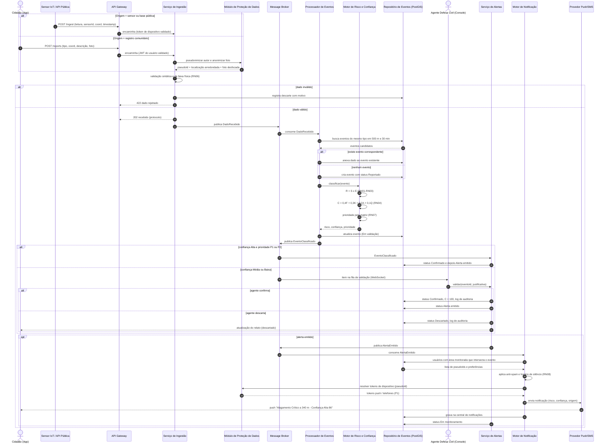
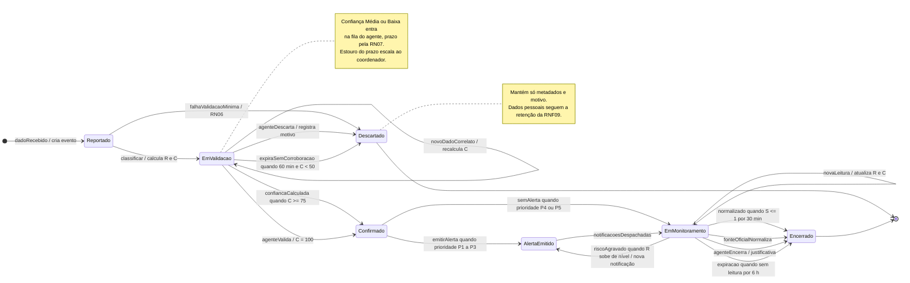
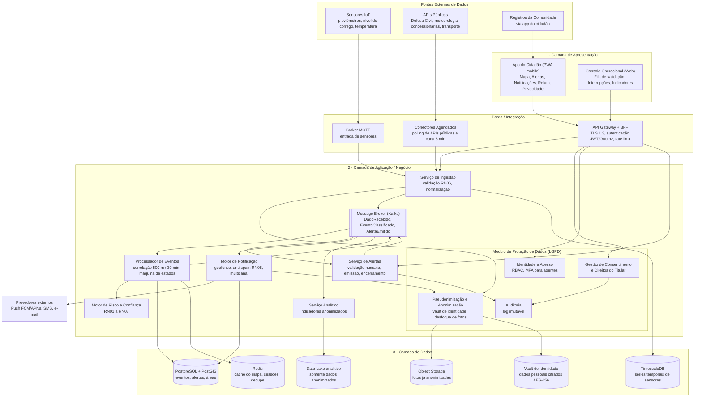

# Urban Risk Intelligence Platform — "Alerta Vivo"
**Global Solution 2026.2 · Engenharia de Software · Contexto CitizenTech**

> **Página de rosto:**
> **Integrantes:**
> - Lucas do Carmo Cima — RM 564964
> - Arthur Ederson de Oliveira Silva — RM 557079
>
> **Protótipo funcional:** https://lucasc-c.github.io/Alerta_Vivo_GS2026/
> **Repositório:** https://github.com/LucasC-C/Alerta_Vivo_GS2026
> **Vídeo de demonstração (YouTube, não listado):** https://youtu.be/1jQ838kpWUM

---

## Sumário
1. Documento de Requisitos
2. Diagramas UML (Sequência e Estados)
3. Visão da Arquitetura em Camadas
4. Mapeamento do Protótipo (10 telas)
5. Matriz de Rastreabilidade (RF ↔ Tela ↔ Componente)
6. Roteiro do Vídeo de Demonstração (≤ 3 min)

---

# 1. Documento de Requisitos

## 1.1 Problema

Cidades como São Paulo convivem com riscos **cotidianos e recorrentes**: alagamentos repentinos em pontos conhecidos, ondas e ilhas de calor em bairros com pouca arborização e interrupções de serviços essenciais (energia, água, transporte). A informação sobre esses riscos existe, mas está **fragmentada**:

- **Sensores** (pluviômetros, medidores de nível de córregos, estações de temperatura) publicam dados em sistemas isolados;
- **Bases públicas** (Defesa Civil, CGE, INMET, concessionárias, operadoras de transporte) usam formatos, frequências e canais diferentes;
- **Moradores** relatam ocorrências em redes sociais e grupos de mensagens, sem verificação e sem chegar a quem decide.

Consequências: alertas chegam **tarde**, **sem localização precisa** ou **sem indicação de credibilidade** (o cidadão não sabe se é boato ou dado oficial), e agentes públicos perdem tempo triando informação duplicada.

**Proposta:** uma plataforma única que **recebe, valida, classifica e prioriza** eventos de risco de três tipos de fonte, exibe tudo em um painel geolocalizado e notifica a pessoa certa, no lugar certo, **sempre mostrando a origem e o nível de confiança de cada dado** — em conformidade com a LGPD.

## 1.2 Público-alvo

| Segmento | Necessidade principal | Canal |
|---|---|---|
| Moradores e trabalhadores da cidade | Saber, antes de sair ou durante o trajeto, se há risco perto de casa/trabalho/rota | App mobile (PWA) |
| Agentes da Defesa Civil | Triar e validar ocorrências rapidamente, emitir e encerrar alertas | Console web |
| Operadores de serviços públicos (energia, água, transporte) | Publicar interrupções e acompanhar o impacto territorial | Console web + API |
| Gestores públicos / pesquisadores | Analisar recorrência e tempo de resposta | Painel analítico (dados anonimizados) |

## 1.3 Personas

### Persona 1 — Marina Souza, moradora
| Atributo | Descrição |
|---|---|
| Idade / ocupação | 34 anos, enfermeira em turnos alternados |
| Local | Mora no Jardim Pantanal (zona leste), trabalha no centro |
| Contexto | Usa ônibus e trem; a rua de casa alaga em chuvas fortes |
| Dores | Recebe boatos no WhatsApp; já perdeu plantão por ficar ilhada; não sabe se a falta de luz é só na casa dela |
| Objetivos | Receber alerta **confiável** e **localizado** com antecedência; relatar alagamentos em segundos |
| Tecnologia | Smartphone Android intermediário, 4G instável |
| Frase | *"Eu só quero saber se é verdade e se é na minha rua."* |

### Persona 2 — Sargento Ricardo Almeida, agente da Defesa Civil
| Atributo | Descrição |
|---|---|
| Idade / ocupação | 46 anos, coordenador regional de Defesa Civil |
| Contexto | Monitora 12 distritos; em dias de chuva recebe centenas de chamados duplicados |
| Dores | Fontes desconectadas, ausência de priorização, dificuldade em separar relato falso de real |
| Objetivos | Fila única ordenada por prioridade; validar/descartar em 1 clique; acompanhar o evento até o encerramento |
| Tecnologia | Desktop com dois monitores na sala de situação + tablet em campo |
| Frase | *"Preciso saber o que é mais grave agora — e se posso confiar."* |

### Persona 3 — Juliana Torres, operadora de serviço público
| Atributo | Descrição |
|---|---|
| Idade / ocupação | 29 anos, analista do centro de operações de uma distribuidora de energia |
| Contexto | Registra interrupções programadas e emergenciais |
| Dores | Comunicação com a população é lenta; o call center lota durante quedas |
| Objetivos | Publicar a interrupção uma vez (ou via API) e atingir apenas os afetados, com previsão de retorno |
| Frase | *"Se o cliente souber a previsão, ele não liga."* |

## 1.4 Requisitos Funcionais

Prioridade (MoSCoW): **Alta = Must**, **Média = Should**, **Baixa = Could**.

| ID | Requisito Funcional | Prioridade | Persona | Tela |
|---|---|---|---|---|
| RF01 | O sistema deve **ingerir dados de sensores IoT** (chuva, nível de córrego, temperatura) via MQTT/HTTP, associando cada leitura ao sensor, coordenada e horário. | Alta | Ricardo | — (backend) / T02 |
| RF02 | O sistema deve **importar dados de bases públicas** (Defesa Civil, meteorologia, concessionárias, transporte) por API/agendamento, normalizando-os em um modelo único de evento. | Alta | Juliana, Ricardo | — / T02 |
| RF03 | O usuário deve poder **registrar uma ocorrência comunitária** informando tipo, localização (GPS ou mapa), descrição e foto opcional. | Alta | Marina | T07, T08 |
| RF04 | O sistema deve **validar** cada dado recebido (formato, faixa física plausível, duplicidade, geolocalização) e **agrupar** registros do mesmo evento (mesmo tipo, raio de 500 m, janela de 30 min). | Alta | Ricardo | T09 |
| RF05 | O sistema deve **calcular o nível de risco** (Baixo, Moderado, Alto, Crítico) de cada evento conforme as regras RN01–RN03. | Alta | Todos | T02, T03, T04 |
| RF06 | O sistema deve **calcular e exibir o nível de confiança** (Alta, Média, Baixa) e a **origem** de cada dado, conforme RN04–RN06. | Alta | Todos | T04, T05 |
| RF07 | O sistema deve exibir um **painel com mapa** dos eventos ativos, com camadas filtráveis por tipo de risco e cor por nível de risco. | Alta | Marina, Ricardo | T02 |
| RF08 | O sistema deve **listar alertas** ordenados por prioridade, com filtros (tipo, nível de risco, confiança, distância) e acesso ao **detalhe** do alerta. | Alta | Marina, Ricardo | T03, T04 |
| RF09 | O sistema deve **enviar notificações** (push, e-mail, SMS para P1) apenas aos usuários cujas áreas monitoradas intersectem a área do evento, conforme a matriz de prioridade (RN07). | Alta | Marina | T06 |
| RF10 | O sistema deve oferecer uma **central de notificações** com histórico, status (lida/não lida) e atalho para o detalhe do alerta. | Alta | Marina | T06 |
| RF11 | O agente da Defesa Civil deve poder **validar, descartar, mesclar, emitir alerta e encerrar** eventos em uma fila de validação ordenada por prioridade. | Alta | Ricardo | T09 |
| RF12 | O operador de serviço público deve poder **publicar interrupções** (área afetada, início, previsão de retorno) pela console ou por API. | Média | Juliana | T09 |
| RF13 | O usuário deve poder **configurar áreas monitoradas** (casa, trabalho, rota), tipos de risco de interesse e horários de silêncio. | Média | Marina | T10 |
| RF14 | O usuário deve poder **gerenciar consentimentos e exercer direitos LGPD** (acessar, exportar, corrigir e excluir seus dados). | Alta | Marina | T01, T10 |
| RF15 | O usuário deve poder **confirmar ou contestar** um evento existente ("também vejo isso" / "não está acontecendo"), alimentando a corroboração. | Média | Marina | T04 |
| RF16 | O sistema deve **atualizar o status** do relato do cidadão (recebido, em validação, confirmado, descartado) e notificá-lo. | Média | Marina | T08, T06 |
| RF17 | O sistema deve exibir **indicadores analíticos** (eventos por região, tempo médio de validação, taxa de falsos positivos) com dados anonimizados. | Baixa | Ricardo, gestores | T09 (aba Indicadores) |

## 1.5 Requisitos Não Funcionais (ISO/IEC 25010)

> Nota didática: a ISO/IEC 25010 foi revisada em 2023. Para evitar ambiguidade na correção, a tabela traz a característica no nome consagrado (edição 2011) e, quando mudou, o nome da edição 2023 entre parênteses. Ex.: "Usabilidade" virou "Capacidade de interação"; "Escalabilidade" passou a ser subcaracterística explícita de "Flexibilidade".

| ID | Característica ISO 25010 | Subcaracterística | Requisito (mensurável) | Aspecto obrigatório |
|---|---|---|---|---|
| RNF01 | Eficiência de desempenho | Comportamento temporal | Leituras de sensores devem aparecer no painel em **≤ 60 s** (p95) após o recebimento; bases públicas devem ser sincronizadas a cada **≤ 5 min**; notificações P1 devem ser entregues ao provedor de push em **≤ 30 s** após a emissão do alerta. | Tempo de atualização |
| RNF02 | Confiabilidade | Disponibilidade | O núcleo (ingestão, processamento e notificação) deve ter disponibilidade mensal de **≥ 99,9%** (≤ 43 min de indisponibilidade/mês), com implantação em pelo menos **2 zonas de disponibilidade**. | Disponibilidade |
| RNF03 | Confiabilidade | Tolerância a falhas / Recuperabilidade | Nenhuma leitura pode ser perdida em caso de falha de um serviço: mensagens ficam retidas no broker por **7 dias** e são reprocessadas; **RPO ≤ 5 min** e **RTO ≤ 15 min**. | Disponibilidade |
| RNF04 | Eficiência de desempenho / (Flexibilidade, 2023) | Capacidade / Escalabilidade | O sistema deve suportar **10.000 leituras/s** e **1 milhão de notificações em 5 min** durante eventos extremos, escalando horizontalmente (autoscaling) sem alteração de código. | Escalabilidade |
| RNF05 | Usabilidade (Capacidade de interação) | Operabilidade / Inteligibilidade | Um morador novo deve conseguir **registrar uma ocorrência em ≤ 3 toques e ≤ 30 s**; o nível de risco deve usar **cor + ícone + texto** (não só cor); taxa de sucesso ≥ 90% em teste com 5 usuários. | Usabilidade |
| RNF06 | Usabilidade (Capacidade de interação) | Acessibilidade | Interfaces devem atender **WCAG 2.1 nível AA** (contraste 4,5:1, suporte a leitor de tela, fonte escalável a 200%). | Usabilidade |
| RNF07 | Segurança | Confidencialidade / Integridade | Dados pessoais criptografados **em trânsito (TLS 1.3)** e **em repouso (AES-256)**; localização do relato é **pseudonimizada** e o mapa público mostra apenas a posição arredondada (grade de ~100 m); acesso por perfil (RBAC) com MFA para agentes. | Segurança / LGPD |
| RNF08 | Segurança | Responsabilização / Não repúdio | Toda ação sobre dados pessoais ou sobre eventos (validar, descartar, emitir, encerrar) gera **log de auditoria imutável** com usuário, data/hora e justificativa, retido por 5 anos. | Segurança / LGPD |
| RNF09 | Segurança (conformidade LGPD) | Confidencialidade | **Minimização e retenção:** histórico de localização do usuário retido por no máximo **30 dias**; fotos de relatos têm rostos e placas desfocados automaticamente; solicitações de titular (Art. 18 LGPD) atendidas em **≤ 15 dias**. | LGPD |
| RNF10 | Compatibilidade | Interoperabilidade | Integração com fontes externas via **REST/JSON, MQTT e GeoJSON**; a API pública segue OpenAPI 3.1. | — |
| RNF11 | Manutenibilidade | Modularidade / Testabilidade | Serviços independentes com cobertura de testes **≥ 70%** nas regras de negócio (motor de risco e confiança). | — |

## 1.6 Regras de Negócio — Priorização de Alertas

A prioridade de um alerta resulta do cruzamento de **duas dimensões independentes**:

- **Nível de risco (R):** *quão grave é* o evento, se for verdadeiro.
- **Nível de confiança (C):** *quão provável é que o dado seja verdadeiro e atual.*

Separar as duas evita o erro clássico de tratar um relato isolado de "alagamento enorme" como crítico e confirmado.

### RN01 — Severidade (S, escala 1 a 5) por tipo de risco

| Tipo | S1 | S2 | S3 | S4 | S5 |
|---|---|---|---|---|---|
| Alagamento (chuva acumulada 1 h) | < 10 mm | 10–24 mm | 25–49 mm | 50–79 mm | ≥ 80 mm |
| Alagamento (nível do córrego vs. cota de transbordo) | < 50% | 50–69% | 70–84% | 85–99% | ≥ 100% |
| Ilha / onda de calor (índice de calor) | < 27 °C | 27–31 °C | 32–40 °C | 41–51 °C | ≥ 52 °C |
| Interrupção de serviço (clientes afetados × duração) | < 100 | 100–999 | 1.000–9.999 | 10.000–49.999 | ≥ 50.000 ou afeta hospital |
| Relato comunitário sem medição | Usuário escolhe intensidade (leve / moderada / grave) → S2 / S3 / S4 (nunca S5 sem medição ou agente) |

Quando há medição e relato para o mesmo evento, vale a **maior severidade medida**.

### RN02 — Exposição (E, escala 1 a 3)

| E | Critério da área afetada |
|---|---|
| 1 | Baixa densidade, sem equipamentos sensíveis |
| 2 | Densidade média **ou** área com histórico de ocorrências (≥ 3 eventos do mesmo tipo em 12 meses) |
| 3 | Alta densidade **ou** presença de hospital, escola, creche, ILPI ou área de risco mapeada pela Defesa Civil |

### RN03 — Nível de risco

**R = S × E** (intervalo 1–15)

| R | Nível de risco | Cor / ícone |
|---|---|---|
| 1–3 | Baixo | Verde · círculo |
| 4–6 | Moderado | Amarelo · triângulo |
| 7–10 | Alto | Laranja · losango |
| 11–15 | Crítico | Vermelho · octógono |

*Exemplo:* chuva de 55 mm/h (S4) em área com escola (E3) → R = 12 → **Crítico**.

### RN04 — Pontuação de confiança (C, 0 a 100)

**C = 0,40·F + 0,30·K + 0,20·A + 0,10·Q**

| Fator | Peso | Como é calculado |
|---|---|---|
| **F — Confiabilidade da fonte** | 40% | API oficial (Defesa Civil, INMET, concessionária) = 95 · Sensor da rede com calibração em dia = 90 · Sensor com calibração vencida ou leitura intermitente = 60 · Relato comunitário = reputação do autor (30 a 80, ver RN05) |
| **K — Corroboração** | 30% | Fontes **independentes** do mesmo evento (mesmo tipo, 500 m, 30 min): 0 outras = 0 · 1 = 50 · 2 = 80 · ≥ 3 ou 1 fonte oficial = 100. Contestações ("não está acontecendo") subtraem 15 cada. |
| **A — Atualidade** | 20% | 100 se o dado tem ≤ 5 min; decai linearmente até 0 aos 60 min |
| **Q — Qualidade do registro** | 10% | Sensor: leitura dentro da faixa física e heartbeat ok = 100. Relato: +40 foto, +30 GPS com precisão ≤ 50 m, +30 descrição preenchida |

| C | Nível de confiança | Selo exibido |
|---|---|---|
| ≥ 75 | **Alta** | "Confirmado por fonte oficial/sensor" ou "Confirmado por N fontes" |
| 50–74 | **Média** | "Parcialmente confirmado" |
| < 50 | **Baixa** | "Relato não verificado" |
| — | **Validado por agente** | Agente da Defesa Civil confirmou → C é fixado em 100 e o selo muda |

**Exemplos resolvidos (são exatamente os dados do protótipo):**

| Evento | F | K | A | Q | Conta | C | Nível |
|---|---|---|---|---|---|---|---|
| **E1** Alagamento na Av. Marechal Tito (fonte primária: pluviômetro PLV-0231; corroboração: sensor de nível CRG-009 + 1 relato de morador) | 90 | 80 (2 fontes) | 95 (idade média 8 min) | 70 | 36 + 24 + 19 + 7 | **86** | Alta → confirmado **automaticamente** |
| **E7** Alagamento na Rua Tietê, **antes** do relato da Marina (1 relato isolado) | 50 | 0 | 100 | 70 | 20 + 0 + 20 + 7 | **47** | Baixa → fila P4 |
| **E7 depois** do relato da Marina (com foto, sem descrição), agrupado por estar a ≤ 500 m | 50 | 50 (1 fonte) | 100 | 70 | 20 + 15 + 20 + 7 | **62** | Média → continua na fila (P4) |
| **E7 depois** da validação pelo agente | — | — | — | — | fixado | **100** | Validado → P3 → agente emite o alerta |

### RN05 — Reputação do relator comunitário

- Todo usuário começa com reputação **50**.
- Relato confirmado: **+5** (máx. 80). Relato descartado como falso: **−10** (mín. 30).
- Usuário com 3 relatos falsos em 30 dias tem novos relatos enviados direto para validação humana, sem contar na corroboração.
- A reputação **não é pública** (LGPD/minimização); o selo exibe só o nível de confiança do evento.

### RN06 — Validação mínima (descarte automático)

Um dado é descartado antes da classificação se: coordenada fora do município; leitura fora da faixa física (ex.: chuva > 300 mm/h, temperatura < −5 °C ou > 60 °C); relato duplicado do mesmo usuário em < 10 min; ou sensor sem heartbeat há > 15 min. O motivo do descarte é registrado.

### RN07 — Matriz de prioridade e ação

| Risco \ Confiança | Alta (≥ 75) | Média (50–74) | Baixa (< 50) |
|---|---|---|---|
| **Crítico** | **P1** – alerta automático: push + SMS, ignora horário de silêncio | **P2** – alerta "em verificação" + validação humana em ≤ 10 min | **P3** – só fila de validação, prazo 15 min |
| **Alto** | **P2** – alerta automático: push | **P3** – fila de validação; push após validar | **P4** – fila de validação |
| **Moderado** | **P3** – push para quem ativou o tipo | **P4** – aparece no mapa, sem push | **P4** – só mapa, com selo "não verificado" |
| **Baixo** | **P4** – só no mapa e na lista | **P5** – só no mapa | **P5** – só registro interno |

**Regra de ouro:** evento com confiança **Baixa** nunca gera notificação push automática.

### RN08 — Anti-spam e silêncio

- Máximo de **3 notificações por hora por usuário**, exceto P1.
- Atualizações do mesmo evento são agrupadas em uma única notificação ("Alagamento na Av. X: risco subiu para Crítico").
- Horário de silêncio configurado pelo usuário é respeitado, exceto P1.

### RN09 — Escalonamento e encerramento

- Evento em validação que ultrapassar o prazo da RN07 é reescalado ao coordenador.
- O evento entra em **Encerrado** quando: os sensores voltam a S ≤ 1 por 30 min, **ou** a fonte oficial informa normalização, **ou** um agente encerra manualmente com justificativa.
- Evento em monitoramento sem nova leitura por 6 h é encerrado automaticamente por expiração.

---

# 2. Diagramas UML (Mermaid.js)

## 2.1 Diagrama de Sequência — Ciclo de um alerta

Participantes = componentes da arquitetura (seção 3). O fluxo mostra as três origens de dado, a validação, a classificação e a notificação, com os desvios por nível de confiança (RN07).



**Leitura do diagrama (para a apresentação):** o `alt` inicial mostra as três origens; o Módulo de Proteção de Dados só atua quando há dado pessoal (relato). O Message Broker desacopla ingestão de processamento: se o processador cair, as mensagens ficam retidas (RNF03). O segundo `alt` implementa a RN07: confiança Alta segue automática; Média/Baixa passa pelo agente.

## 2.2 Diagrama de Estados — Ciclo de vida de um evento de risco



### Tabela de transições (complementa o diagrama)

| De | Evento | Condição (guarda) | Ação | Para |
|---|---|---|---|---|
| — | dadoRecebido | dado sem evento correspondente | criar evento | Reportado |
| Reportado | classificar | dado passou na RN06 | calcular R, C, prioridade | Em validação |
| Reportado | falhaValidacaoMinima | regra RN06 violada | registrar motivo | Descartado |
| Em validação | confiancaCalculada | C ≥ 75 | — | Confirmado |
| Em validação | agenteValida | perfil = Agente | fixar C = 100, auditar | Confirmado |
| Em validação | agenteDescarta | perfil = Agente | auditar, reputação −10 | Descartado |
| Em validação | expiraSemCorroboracao | 60 min e C < 50 | — | Descartado |
| Confirmado | emitirAlerta | prioridade P1–P3 | publicar AlertaEmitido | Alerta emitido |
| Confirmado | semAlerta | prioridade P4–P5 | só exibir no mapa | Em monitoramento |
| Alerta emitido | notificacoesDespachadas | — | gravar central de notificações | Em monitoramento |
| Em monitoramento | riscoAgravado | R mudou para nível superior | nova notificação | Alerta emitido |
| Em monitoramento | normalizado / fonteOficialNormaliza / agenteEncerra / expiracao | ver RN09 | notificar "situação normalizada" | Encerrado |

---

# 3. Visão da Arquitetura em Camadas

## 3.1 Diagrama (Mermaid.js)



## 3.2 Estrutura em árvore

```text
Urban Risk Intelligence Platform
├── Fontes Externas
│   ├── Sensores IoT ............... MQTT (QoS 1)
│   ├── APIs Públicas .............. REST/JSON, GeoJSON (polling 5 min ou webhook)
│   └── Comunidade ................. relatos pelo App do Cidadão
│
├── 1. Apresentação
│   ├── App do Cidadão (PWA) ....... T01–T08, T10
│   └── Console Operacional (Web) .. T09 (fila, interrupções, indicadores)
│
├── Borda / Integração
│   ├── API Gateway + BFF .......... TLS, JWT, rate limiting, WAF
│   ├── Broker MQTT
│   └── Conectores agendados
│
├── 2. Aplicação / Negócio
│   ├── Serviço de Ingestão ........ validação RN06, normalização
│   ├── Message Broker (Kafka) ..... desacoplamento, retenção 7 dias
│   ├── Processador de Eventos ..... ★ PROCESSAMENTO DE EVENTOS (correlação + estados)
│   ├── Motor de Risco e Confiança . RN01–RN07
│   ├── Serviço de Alertas ......... validação humana, emissão, encerramento
│   ├── Motor de Notificação ....... ★ NOTIFICAÇÃO (geofence, RN08, push/SMS/e-mail)
│   ├── Serviço Analítico .......... RF17
│   └── Módulo de Proteção de Dados  ★ LGPD (transversal)
│       ├── Identidade e Acesso (RBAC, MFA)
│       ├── Consentimento e Direitos do Titular
│       ├── Pseudonimização / Anonimização
│       └── Auditoria (log imutável)
│
└── 3. Dados
    ├── PostgreSQL + PostGIS ....... eventos, alertas, áreas monitoradas
    ├── TimescaleDB ................ séries temporais
    ├── Redis ...................... cache e deduplicação
    ├── Object Storage ............. fotos anonimizadas
    ├── Vault de Identidade ........ dados pessoais cifrados
    └── Data Lake .................. analytics anonimizado
```

## 3.3 Onde ficam os elementos exigidos

| Elemento | Camada / módulo | Responsabilidade | Requisitos atendidos |
|---|---|---|---|
| **Processamento de eventos** | Aplicação → **Processador de Eventos** + **Motor de Risco e Confiança**, consumindo do Message Broker | Correlaciona dados em eventos, executa a máquina de estados (seção 2.2), calcula R, C e prioridade | RF04, RF05, RF06, RNF01, RNF04 |
| **Motor de notificação** | Aplicação → **Motor de Notificação** | Consome `AlertaEmitido`, cruza o polígono do evento com as áreas monitoradas (consulta espacial PostGIS `ST_Intersects`), aplica RN08 e despacha para push/SMS/e-mail | RF09, RF10, RNF01, RNF04 |
| **Proteção de dados pessoais (LGPD)** | **Transversal**: Borda (TLS, autenticação no Gateway) + Aplicação (**Módulo de Proteção de Dados**) + Dados (**Vault de Identidade** cifrado, data lake só anonimizado) | Os serviços de negócio trabalham com **pseudoId**, nunca com nome/telefone. Só o Motor de Notificação, via Módulo de Proteção, resolve o pseudoId em token de dispositivo no momento do envio. | RF14, RNF07, RNF08, RNF09 |

**Por que essa arquitetura (decisões de engenharia):**
- **Orientada a eventos com broker:** a ingestão responde `202` rápido e o processamento é assíncrono. Picos de chuva viram fila, não queda de sistema → disponibilidade (RNF02/03) e escalabilidade (RNF04): basta adicionar consumidores ao grupo do Kafka.
- **PostGIS:** consultas como "eventos a 500 m" e "usuários cuja área intersecta o alerta" usam índice espacial GiST (R-tree), com custo de busca aproximadamente logarítmico em vez de varrer todas as linhas.
- **Separação de identidade (vault):** reduz o impacto de vazamento: quem invadir o banco de eventos não encontra quem relatou o quê (privacy by design, Art. 46 LGPD).

---

# 4. Mapeamento do Protótipo (10 telas)

**Padrões visuais comuns a todas as telas**
- Cores de risco: Verde (Baixo), Amarelo (Moderado), Laranja (Alto), Vermelho (Crítico), sempre com ícone e texto (RNF05/06).
- **Selo de confiança** (componente reutilizável): pílula com ícone de escudo + texto "Confiança Alta / Média / Baixa / Validado pela Defesa Civil". Tocar no selo abre a T05.
- Barra inferior do App do Cidadão: **Mapa · Alertas · Relatar (botão central destacado) · Notificações · Perfil**.

### T01 — Boas-vindas, login e consentimento LGPD
| Item | Conteúdo |
|---|---|
| Objetivo | Cadastro mínimo e consentimento granular |
| Dados exibidos | Logo, proposta em 1 frase, campos: e-mail ou telefone (código por SMS); nada de CPF |
| Consentimentos (toggles separados) | ☐ Localização em tempo real para alertas próximos (opcional) · ☐ Receber notificações push · ☐ Usar meus relatos de forma anonimizada para estatísticas · Link "Política de Privacidade" e "Como usamos seus dados" |
| Botões | **Continuar**, Entrar como visitante (só mapa), Sou agente público (login com MFA → T09) |
| Requisitos | RF14, RNF07, RNF09 |

### T02 — Painel de acompanhamento (mapa)
| Item | Conteúdo |
|---|---|
| Objetivo | Visão geral dos riscos ativos ao redor |
| Topo | Barra de busca de endereço · cartão-resumo: "4 alertas ativos até 2 km · 1 Crítico" · indicador "Ao vivo · há 40 s" (RNF01) |
| Mapa | Marcadores coloridos por risco; polígonos de área afetada; ponto azul do usuário; suas áreas monitoradas (casa/trabalho) contornadas |
| Filtros (chips) | Alagamento · Calor · Energia · Água · Transporte · "Só confiança Alta" |
| Bottom sheet ao tocar marcador | Tipo + ícone, título, bairro, distância ("340 m de você"), nível de risco, **selo de confiança** ("Confiança Alta 86"), prioridade (P1), origem resumida ("2 sensores + 1 morador"), botões **Ver detalhes** (→ T04) e **Origem dos dados** (→ T05) |
| Botão flutuante | **+ Relatar ocorrência** (→ T07) |
| Requisitos | RF07, RF05, RF06 |

### T03 — Lista de alertas
| Item | Conteúdo |
|---|---|
| Objetivo | Ver todos os alertas ordenados por prioridade |
| Abas | Perto de mim · Minhas áreas · Toda a cidade |
| Cartão de alerta | Ícone do tipo, título ("Alagamento — Av. Marechal Tito"), nível de risco (faixa colorida), **selo de confiança**, origem resumida ("2 sensores + 1 morador"), distância, horário, status (Ativo / Em monitoramento / Encerrado) |
| Filtros | Tipo, nível de risco, confiança (Validado / Alta / Média / Baixa) · ver/ocultar encerrados · ordenar por Prioridade (padrão) ou Mais recentes |
| Ações | Tocar cartão → T04 |
| Requisitos | RF08, RF05, RF06 |

### T04 — Detalhe do alerta
*Exemplo de tela: evento **E1**, o mesmo do protótipo.*

| Item | Conteúdo |
|---|---|
| Cabeçalho | Tipo + prioridade **P1**, nível de risco em destaque (**CRÍTICO**, octógono vermelho), "Alagamento na Av. Marechal Tito", "Av. Marechal Tito, alt. nº 6.200 · Jardim Pantanal", status **Em monitoramento** · "340 m de você" |
| Bloco "Origem e confiança" (resumo) | Selo **Confiança Alta 86** · lista curta: "Pluviômetro PLV-0231 · Sensor IoT", "Sensor de nível CRG-009 · Sensor IoT", "Relato de morador · Registro comunitário" · botão **Ver origem dos dados e cálculo** (→ T05) |
| Mini-mapa | Área afetada (raio de ~450 m) + posição do usuário |
| Bloco "O que está acontecendo" | "Chuva de 55 mm/h na última hora e Córrego Três Pontes a 92% da cota de transbordo. Água acima do meio-fio em dois quarteirões." · Severidade: **S4** (55 mm/h, faixa 50–79 mm) · Exposição: **E3** (EMEF a 200 m e área de risco mapeada) |
| Bloco "O que fazer" | Evite a área e passagens subterrâneas · não atravesse água corrente · desligue a energia se a água entrar em casa · botões **Defesa Civil 199** e **Bombeiros 193** |
| Linha do tempo (espelha o Diagrama de Estados) | 18:02 Reportado (PLV-0231 passou de 50 mm/h) → 18:02 Em validação (R = 4 × 3 = 12, C = 86) → 18:03 **Confirmado automaticamente (C ≥ 75)** → 18:03 Alerta emitido (P1: push + SMS) → 18:04 Em monitoramento → 18:12 Atualização (córrego a 92%) |
| Botões | **Também estou vendo** (corroboração +1: K 80 → 100, C 86 → 92) · **Não está acontecendo** (contestação: K −15) · Compartilhar |
| Requisitos | RF08, RF06, RF15 |

### T05 — Origem e nível de confiança do dado ★ (tela obrigatória)
*Exemplo de tela: evento **E1**. Não há validação humana: o evento foi confirmado **automaticamente** porque C = 86 ≥ 75 (RN04/RN07).*

| Item | Conteúdo |
|---|---|
| Objetivo | Transparência total sobre **de onde veio** e **quanto confiar** |
| Topo | Medidor circular (gauge) **86 de 100** + selo **Confiança Alta 86** · legenda "Alta ≥ 75 · Média 50–74 · Baixa < 50 · Validado por agente = 100" |
| "Como a nota foi calculada" (barras) | **F** Confiabilidade da fonte 90 (peso 40% → +36,0) · **K** Corroboração 80 (30% → +24,0) · **A** Atualidade 95 (20% → +19,0) · **Q** Qualidade 70 (10% → +7,0) · cada barra tem um "Por quê?" expansível |
| Fórmula exibida | `0,4×90 + 0,3×80 + 0,2×95 + 0,1×70 = 86` |
| "De onde veio a informação" (3 cartões) | 📡 **Pluviômetro PLV-0231** · *Principal* · Sensor IoT · rede municipal, calibração em dia (ago/2026), leitura 55 mm/h · 18:13 · 📡 **Sensor de nível CRG-009** · Sensor IoT · Córrego Três Pontes a 92% da cota, heartbeat ok · 18:12 · 👥 **Relato de morador** · Registro comunitário · autor anônimo (pseudonimizado), GPS ± 30 m, sem foto · 18:04 |
| "Por que este evento é P1?" | Risco Crítico (R = 4 × 3 = 12) × Confiança Alta → **P1** (push + SMS, ignora horário de silêncio), com a matriz RN07 e a célula atual destacada |
| Variante "validado" | Quando um agente valida um evento (ex.: E7), aparece o aviso "Validado por agente da Defesa Civil às HH:MM", o selo vira **Validado pela Defesa Civil 100** e entra o cartão de fonte "Defesa Civil — validação humana" (sem o nome do agente) |
| Rodapé (LGPD) | "Dados pessoais de quem relatou não são exibidos. Autores pseudonimizados, fotos desfocadas, posição pública arredondada em ~100 m." |
| Requisitos | RF06, RNF05, RNF07 |

### T06 — Central de notificações
| Item | Conteúdo |
|---|---|
| Abas | Todas · Alertas · Meus relatos · Sistema |
| Item da lista | Ícone de risco, título, trecho ("Alagamento CRÍTICO a 340 m — Av. Marechal Tito · Confiança Alta (86)"), horário, ponto azul se não lida; atualizações agrupadas ("+2 atualizações agrupadas (RN08)") |
| Exemplos | "Seu relato foi confirmado pela Defesa Civil — obrigado!" · "Situação normalizada: Av. Marechal Tito" · "Interrupção de energia na sua área — retorno previsto 21:30" |
| Ações | Tocar → T04 ou T08 · Marcar todas como lidas · ⚙ Preferências de notificação (→ T10) |
| Requisitos | RF09, RF10, RF16 |

### T07 — Registro comunitário de ocorrência
| Item | Conteúdo |
|---|---|
| Objetivo | Relatar em ≤ 3 toques / 30 s (RNF05) |
| Passo 1 — Tipo (grade de ícones grandes) | Alagamento · Calor extremo · Falta de energia · Falta de água · Problema no transporte · Outro |
| Passo 2 — Local | Mapa com pino na posição GPS (arrastável) + precisão ("± 15 m") + endereço aproximado |
| Passo 3 — Detalhes (opcional) | Intensidade: Leve / Moderada / Grave · Foto (aviso: "rostos e placas serão desfocados") · Descrição curta (140 caracteres) |
| Botões | Passo 2: **Enviar agora** (atalho de 3 toques) ou **Adicionar detalhes** · Passo 3: **Enviar relato** · Cancelar/Voltar |
| Aviso | "Seu nome não aparece para outros usuários." |
| Requisitos | RF03, RNF05, RNF07, RNF09 |

### T08 — Confirmação e acompanhamento do meu relato
| Item | Conteúdo |
|---|---|
| Confirmação | ✅ "Relato recebido!" · protocolo #URB-2026-004812 |
| Stepper de status (espelha o diagrama de estados) | Recebido → Em validação → Confirmado → Alerta emitido → Em monitoramento → Encerrado (ou Descartado, com o motivo) |
| Informação | Exemplo do protótipo: relato na Rua Tietê → "Seu relato se juntou a 1 outra fonte sobre o mesmo local" (evento E7, confiança 47 → **62**, Média) · selo de confiança atual do evento |
| Lista "Meus relatos" | histórico com status de cada um |
| Botões | Ver no mapa (→ T02) · Ver alerta relacionado (→ T04) |
| Requisitos | RF16, RF03 |

### T09 — Console da Defesa Civil / Operador (web)
| Item | Conteúdo |
|---|---|
| Cabeçalho | Usuário logado + seletor de perfil (RBAC): **Sgt. Ricardo Almeida — Defesa Civil** ou **Juliana Torres — Operadora de energia** · selo "MFA ativo" · atalho para o app do cidadão |
| Aba "Fila de validação" | Mapa à esquerda; fila única à direita, ordenada P1→P5 e depois por tempo na fila, com cronômetro do prazo (P2 = 10 min, P3 = 15 min) e selo **"Escalado"** quando o prazo estoura (RN09) |
| Cartão da fila | Prioridade, tipo, título, origem, tempo na fila, risco (R = S×E), **selo de confiança** + valores F/K/A/Q, resumo, fotos desfocadas |
| Ações | Em validação: **Validar** · **Descartar** (motivo obrigatório) · **Mesclar com…** — Confirmado: **Emitir alerta** (prévia da mensagem e do alcance) · **Manter só no mapa** |
| Aba "Eventos ativos" | Tabela com os eventos em Alerta emitido / Em monitoramento → **Encerrar** (condição RN09 + justificativa) |
| Aba "Interrupções" (operadora) | Formulário: serviço, área, início, previsão de retorno, afetados, "afeta hospital" → prévia automática de S, E, R, C e prioridade → **Publicar** · exemplo de chamada `POST /api/v1/interrupcoes` |
| Aba "Indicadores" | Eventos ativos, alertas emitidos, tempo médio de validação (6m40s), relatos falsos (12%), latência p95 (38 s), disponibilidade (99,96%), barras por região e por tipo (dados anonimizados) |
| Aba "Auditoria" | Log imutável: hora, usuário, ação, evento, justificativa e cadeia de hashes (RNF08) |
| RBAC | A operadora acessa só Interrupções e Indicadores |
| Requisitos | RF04, RF11, RF12, RF17, RNF08 |

### T10 — Perfil, preferências e privacidade
| Item | Conteúdo |
|---|---|
| Minhas áreas | Casa, Trabalho, Rota diária (desenhar no mapa, raio 500 m / 1 km / 2 km) |
| Preferências | Tipos de risco que quero receber · nível mínimo para push · horário de silêncio (ex.: 23h–6h, "exceto Crítico") · canais (push, e-mail) |
| Privacidade (LGPD) | Consentimentos (ligar/desligar) · **Baixar meus dados** · **Corrigir dados** · **Excluir minha conta** · Histórico de localização: "guardado por 30 dias" · contato do Encarregado (DPO) |
| Requisitos | RF13, RF14, RNF09 |

## 4.1 Fluxo principal de navegação (ponta a ponta)

**Fluxo A — Morador recebe e entende um alerta (fluxo principal do vídeo)**
```text
T01 Login/Consentimento
 └─► T02 Painel (mapa)
      ├─► [toca marcador] ─► T04 Detalhe do alerta
      │                        └─► [toca "Ver origem dos dados"] ─► T05 Origem e Confiança
      ├─► [aba Alertas] ─► T03 Lista ─► T04 Detalhe
      └─► [botão Relatar] ─► T07 Registro ─► T08 Acompanhamento ─► T02
Push recebido ─► T06 Central de Notificações ─► T04 Detalhe ─► T05
```

**Fluxo B — Agente valida e emite alerta**
```text
T01 (login agente + MFA) ─► T09 Fila de validação ─► Validar ─► Emitir alerta
   └─► (sistema) push ao morador ─► T06 do morador ─► T04 ─► Encerrar evento em T09
```

**Fluxo C — Ciclo completo do relato (demonstra coerência com o Diagrama de Estados)**
```text
Morador: T07 Relatar ─► T08 "Em validação"
Agente:  T09 Validar + Emitir alerta
Morador: T06 "Seu relato foi confirmado" ─► T08 "Confirmado" ─► T04 Detalhe ─► T05 Origem
Agente:  T09 Encerrar ─► Morador: T06 "Situação normalizada"
```

> Dica para o Figma: crie o **selo de confiança** e o **cartão de alerta** como *Components* com variantes (Alta/Média/Baixa; Baixo/Moderado/Alto/Crítico). Isso garante a consistência visual cobrada no critério de 4,0 pontos e acelera muito o desenho das 10 telas.

---

# 5. Matriz de Rastreabilidade

| RF | Tela(s) | Componente da arquitetura | Diagrama |
|---|---|---|---|
| RF01 Ingestão de sensores | T02 | Broker MQTT → Ingestão | Sequência (alt sensor) |
| RF02 Importação de bases públicas | T02, T05 | Conectores → Ingestão | Sequência (alt sensor/API) |
| RF03 Registro comunitário | T07, T08 | App → Gateway → Ingestão → Proteção de Dados | Sequência (alt comunidade) / Estados (Reportado) |
| RF04 Validação e agrupamento | T09 | Ingestão + Processador de Eventos | Sequência / Estados (Em validação) |
| RF05 Nível de risco | T02, T03, T04 | Motor de Risco e Confiança | Sequência (RISK) |
| RF06 Origem e confiança | T04, **T05** | Motor de Risco e Confiança | Sequência (RISK) |
| RF07 Painel com mapa | T02 | BFF + Redis + PostGIS | — |
| RF08 Lista e detalhe de alertas | T03, T04 | Serviço de Alertas | — |
| RF09 Notificações segmentadas | T06 | Motor de Notificação | Sequência (opt alerta) |
| RF10 Central de notificações | T06 | Motor de Notificação | Sequência |
| RF11 Validação pelo agente | T09 | Serviço de Alertas + Auditoria | Sequência / Estados |
| RF12 Interrupções de serviço | T09 | Gateway → Ingestão | Sequência (alt API) |
| RF13 Áreas monitoradas | T10 | BFF + PostGIS | — |
| RF14 Consentimento e direitos LGPD | T01, T10 | Módulo de Proteção de Dados | — |
| RF15 Confirmar / contestar | T04 | Ingestão → Processador | Estados (novoDadoCorrelato) |
| RF16 Status do relato | T08, T06 | Serviço de Alertas → Notificação | Estados |
| RF17 Indicadores | T09 | Serviço Analítico + Data Lake | — |

Todas as telas têm pelo menos um RF e todo RF de interface tem tela: atende ao "ponto de atenção" de coerência do enunciado.

---

# 6. Roteiro do Vídeo de Demonstração (≤ 3 min)

**Formato:** gravação de tela do protótipo funcional (`index.html`) com a barra de demonstração oculta (tecla **D**); narração por 1 apresentador ou alternada entre os integrantes. Clique em **Resetar** antes de gravar. Total planejado: **2 min 55 s**.

| Tempo | Tela / ação no protótipo | Fala (narração exata) |
|---|---|---|
| **0:00–0:18** | Imagens de rua alagada e mensagens de WhatsApp com boatos | "Toda semana, alguém em São Paulo fica ilhado num alagamento que já tinha acontecido ali antes. O problema não é falta de dado. É que a informação está espalhada, chega tarde e ninguém sabe em qual confiar." |
| **0:18–0:35** | Tela T01 | "Por isso criamos o Alerta Vivo, uma Urban Risk Intelligence Platform. Ela junta sensores, bases públicas e relatos de moradores, calcula o risco e a confiança de cada evento e avisa só quem está na área. A Marina se cadastra só com o telefone e escolhe, um por um, o que autoriza, conforme a LGPD." |
| **0:35–0:52** | Clicar em **Continuar como cidadão** → T02 | "No painel, ela vê quatro alertas ativos a até dois quilômetros, um deles crítico. Cada nível de risco tem cor, forma e texto. E o mapa está ao vivo: atualizado há segundos." |
| **0:52–1:05** | O push chega sozinho (~3 s) → tocar no push | "Chega uma notificação: alagamento crítico a 340 metros, na Avenida Marechal Tito, com confiança alta." |
| **1:05–1:22** | T04 — rolar até a linha do tempo | "No detalhe, ela vê o que está acontecendo — 55 milímetros de chuva por hora e o córrego a 92% da cota —, o que fazer e a linha do tempo. O evento foi confirmado automaticamente, porque a confiança passou de 75." |
| **1:22–1:52** | Tocar no **selo de confiança** → T05 | "Ao tocar no selo, ela vê de onde vem a informação: um pluviômetro da rede municipal, confirmado por um sensor de nível do córrego e pelo relato de um morador. E vê a conta: fonte 90, corroboração 80, atualidade 95 e qualidade 70. Com os pesos, dá 86 de 100. Risco crítico com confiança alta é prioridade P1. Nada de caixa-preta, e nenhum dado pessoal de quem relatou aparece." |
| **1:52–2:15** | T07: Alagamento → pino na Rua Tietê → **Adicionar detalhes** → foto → **Enviar relato** → T08 | "A Marina também pode ajudar. Ela relata um alagamento na Rua Tietê, com foto; rostos e placas são desfocados. Como já existia um relato a menos de 500 metros, o dela é agrupado: a confiança sobe de 47 para 62. Ainda é média, então vai para a validação humana." |
| **2:15–2:40** | T09: **Validar** → **Emitir alerta** → **Emitir agora** | "Na sala de situação, o sargento Ricardo vê uma fila única por prioridade, com prazo para cada item. Ele valida o relato, a confiança vai para 100 e ele emite o alerta para os vizinhos. Cada ação fica registrada em auditoria." |
| **2:40–2:55** | T06 com "Seu relato foi confirmado" → T08 com o stepper avançado + logo | "A Marina recebe a confirmação e acompanha o ciclo até o encerramento. Alerta Vivo: informação certa, para a pessoa certa, no lugar certo." |

**Dicas de gravação:** grave a voz separada e sincronize na edição; mantenha o cursor visível nos cliques do T05 (é o "requisito central do tema"); publique no YouTube como **não listado** e teste o link em janela anônima.

---

## Checklist de entrega (do enunciado)
- [x] Nomes completos e RMs na primeira página + links
- [x] Problema, público-alvo e personas
- [x] 17 RF e 11 RNF (ISO 25010) com LGPD
- [x] Regras de priorização, risco e confiança (RN01–RN09)
- [x] Diagrama de Sequência
- [x] Diagrama de Estados
- [x] Arquitetura em camadas
- [x] Protótipo funcional com as 10 telas (`index.html`) + README
- [ ] Links públicos testados em janela anônima (protótipo, repositório e vídeo)
- [x] Vídeo ≤ 3 min (2:49): https://youtu.be/1jQ838kpWUM
